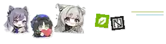

  

  

  <h2>Muhammad Farhan</h2>
  
<b>Physics Undergraduate @ Universitas Indonesia</b>

  
Scientific Computing · Signal Processing · Embedded Systems · Agentic AI

  
  
  

---

<h3 align="center">About Me</h3>

I'm a Physics undergraduate interested in turning real-world signals and physical systems into useful computational tools. My work spans deep learning for time-series data, seismic signal denoising, electronic instrumentation, microcontroller development, and the deployment of agentic AI workflows.

I care about more than getting a model or circuit to run: I want the whole system to be measurable, debuggable, reproducible, and properly documented.

<h3 align="center">Tech Stack</h3>

<h4 align="center">Languages & Scientific Computing</h4>

  

<h4 align="center">Microcontrollers & Embedded</h4>

  
  
  
  
  

<h4 align="center">AI, Machine Learning & Agentic Systems</h4>

  
  
  
  

<h4 align="center">Tools & Platforms</h4>

  
   
  
  
  

<h3 align="center">Interests</h3>

⚙️ Embedded Systems &nbsp; · &nbsp; 📈 Signal Processing &nbsp; · &nbsp; 🧠 Machine Learning &nbsp; · &nbsp; 🤖 Agentic AI &nbsp; · &nbsp; 🔬 Computational Physics

<h3 align="center">GitHub Statistics</h3>

  
  
   
  
   
  

<h3 align="center">Currently Learning</h3>

  
  
  

  
<b>More about my current focus</b>

  <ul>
    <li><b>Agentic AI:</b> Hermes profiles, tool orchestration, local deployment, Discord integration, and a Mission Control dashboard for tasks and activity.</li>
    <li><b>Embedded systems:</b> PlatformIO workflows, MCU firmware, electronic instrumentation, and circuit documentation.</li>
    <li><b>Signal processing:</b> waveform denoising, time-series analysis, and practical ML pipelines with traceable evaluation.</li>
  </ul>

<h3 align="center">Selected Work</h3>

  
  
  

<h3 align="center">Connect With Me</h3>

  
  
  
  

<i>Building the bridge between physical systems and intelligent software.</i>

  

